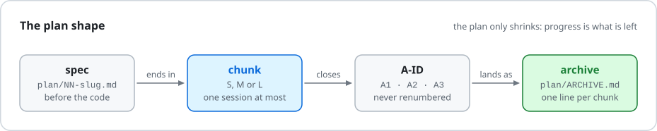
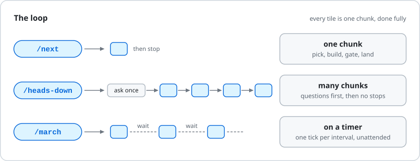
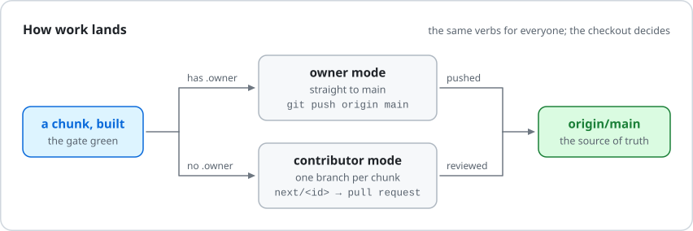

# nexus

> Turn a repo into a project that ships itself. You write a
> spec; nexus breaks it into chunks and gives your agent the
> verbs to build them one at a time: pick, build, gate,
> commit, push. Run one by hand tonight; loop it over the
> weekend. Stack-agnostic, agent-agnostic, $0 marginal on
> Claude Pro/Max and a public repo.

[](./LICENSE)
[](https://claude.com/claude-code)
[](https://www.npmjs.com/package/@usenexus/cli)
[](#)
[](#)
[](./CONTRIBUTING.md)

[](https://github.com/daretodave/nexus/actions/workflows/march.yml)
This kit ships itself: nexus is adopted on its own repo, running the loop the badge above tracks — see [`nexus runs on nexus`](#nexus-runs-on-nexus) for the full case.

## Is this for you?

**Use nexus when:** you have a **definite product** in some
form of `spec.md`; you're willing to invest **2–3 hours of
setup** for hours-to-days of unattended build time; you can
let `main` deploy automatically; and you're comfortable with
an agent deciding-and-shipping without per-commit review
(`/oversight` and the audit logs keep you honest after).

**Skip it — or use a playbook instead of the TL;DR fast path
below — when:** the product is exploratory and needs human
input per decision; the repo has security-critical paths
needing per-commit review; you have no spec yet (write a
one-pager first — see [pre-spec](#tldr--i-have-a-pitch-no-spec-yet)
if you only have a pitch); the repo is in active
multi-developer flux; or you're skeptical of unattended
adoption and want to read the methodology first.

The TL;DR doors ahead are for "I trust the methodology, save
me the keystrokes." The playbooks are for everyone else.

### Used v1? On v2?

**Used v1?** One command moves a phase-plan repo to specs and
chunks — a dry run at the repo's root, from a fresh fetch, that
never touches your checkout (`--land owner` lands it between
ticks, `--rollback` undoes it):

```bash
npx @usenexus/cli upgrade            # the report: files, archive lines, the first tick it predicts
npx @usenexus/cli upgrade --write    # one commit on nexus/upgrade-v2, nothing pushed
```

**On v2?** The same command syncs to the latest kit (edits
merged three ways; the GUI flags it with a `nexus <version> is
out` banner). **No checkout?** `--repo owner/name --pr` runs it
from a temporary clone and opens a pull request instead.

Runbook: [`playbooks/upgrade.md`](./playbooks/upgrade.md); any
other agent follows
[`prompts/upgrade.md`](./prompts/upgrade.md) the same way.

---

## Three doors in

Pick one. Each ends in the same place: your repo adopted, a
plan of chunks, and `/next` ready to build the first.

### 1. Using Claude Code? A GUI on us, free.

```bash
npx @usenexus/cli
```

Run it at your project's root — local server, your own Claude
Code login (no API key), adopts nexus if new, a live cockpit
per session ([`packages/cli`](./packages/cli/README.md));
scripts use `npx @usenexus/cli run "<prompt>"`, JSON out.


The GUI in motion — [still frame](./assets/gifs/fleet-to-tug.png)
for less motion, recorded from the `fleet-to-tug` demo
([how](./packages/cli/README.md#recording-a-gif-of-a-demo)).

### 2. Any other agent? Give it this prompt.

Paste it at your project's root — Cursor, Codex, Claude Code
without the GUI, any agent that reads files and runs git:

```
Clone https://github.com/daretodave/nexus.git to
../nexus (or use ./.nexus if submoduled) if you haven't
already, then read and follow ../nexus/prompts/adopt.md
exactly, in order. Do not skip steps or invent scope beyond
what it says.
```

Full authorization: [`prompts/adopt.md`](./prompts/adopt.md);
detail [below](#tldr--clone--delegate-the-adoption). Pitch,
no spec? [Start here](#tldr--i-have-a-pitch-no-spec-yet).

### 3. By hand? Follow a playbook.

[`playbooks/new-project.md`](./playbooks/new-project.md)
(greenfield) or
[`playbooks/existing-project.md`](./playbooks/existing-project.md)
(brownfield). Not sure which, or starting from a pitch, or
outgrown one repo? [Pick a playbook](#pick-a-playbook) below
routes every case — ten minutes to read each.

## TL;DR — clone + delegate the adoption

> Door 2 in detail. Use this if you already have a `spec.md`.
> If you only have a verbal pitch, jump down to
> [TL;DR — I have a pitch, no spec yet](#tldr--i-have-a-pitch-no-spec-yet).

### 1. Clone

Clone nexus next to your project (or your fork of it: swap the
URL here and in the prompt below):

```bash
# Sibling layout — recommended
cd <parent-of-your-project>
git clone https://github.com/daretodave/nexus.git nexus
ls
# my-project/   nexus/
```

Submoduling instead? `git submodule add <url> .nexus` and
treat `./.nexus` as the nexus root throughout.

### 2. Hand it to your agent

Paste the prompt from [door 2](#2-any-other-agent-give-it-this-prompt)
at your project's root (where `git status` shows your repo).
Full instructions: [`prompts/adopt.md`](./prompts/adopt.md) —
read it first to know what you're authorizing
([`prompts/README.md`](./prompts/README.md): what else lives
in that directory).

### 3. Review what landed

When the agent returns, expect: a new commit titled `chore:
adopt nexus methodology`; files added (`agents.md`,
`CLAUDE.md`, `plan/`, `skills/`, `.claude/`, `scripts/`,
`.env.example`), existing source code **untouched**; any
`[needs-user-call]` rows in `plan/AUDIT.md` the agent deferred
to you; and `pnpm verify` / `pnpm deploy:check` specified and
ready to wire — not necessarily passing yet.

Read the diff, resolve `[needs-user-call]` rows (edit the
files, or run `/oversight`), populate `.env`. **Then run
`/next` for the first time** — by hand, level 0 of the
intervention spectrum. Don't skip to `/loop /march`.

---

## TL;DR — I have a pitch, no spec yet

> No `spec.md` yet, just a working name and a one-paragraph
> pitch? This runs the pre-spec interview, writes `spec.md`,
> then hands off to the adoption flow above — end-to-end in
> one paste.

Paste this at your project's root (where `git init` has run
but there's nothing else yet); swap the URL if you use a fork:

```
Clone https://github.com/daretodave/nexus.git to
../nexus (or use ./.nexus if submoduled) if you haven't
already, then read and follow ../nexus/prompts/pitch.md
exactly, in order.

Here's my pitch in my own words:

  <ONE-PARAGRAPH PITCH — what the product is, who it's for,
  what makes it interesting. Don't polish.>
```

Full instructions: [`prompts/pitch.md`](./prompts/pitch.md).
Pitch quality matters — the agent will not invent product
direction for you.

---

## How it works



**The plan.** Each spec under `plan/` ends in chunks (S/M/L,
one session each) that close acceptance IDs (`A1`, `A2`, never
renumbered); a finished chunk leaves one line in
`plan/ARCHIVE.md` — the plan only shrinks. See
[`concepts/plan-shape.md`](./concepts/plan-shape.md).



**The verbs.** `/next` builds one chunk and stops;
`/heads-down` claims a list and loops `/next` on defaults;
`/march` is the timed dispatcher, by hand or on GitHub Actions.
Full verb list: [What you get](#what-you-get), below.



**Owner mode.** The checkout decides how a chunk lands: the
owner (an untracked `.owner` file) pushes main directly; every
other checkout opens a pull request on `next/<id>`. See
[`playbooks/owner-mode.md`](./playbooks/owner-mode.md).

---

## What you get

User-facing verbs, then the loop's own (dispatched by `/march`
or run by hand):

| Command | Job |
|---|---|
| `/next` | One chunk, done fully: pick the first ready chunk, claim it, build it (a delegated builder), gate, close, land per owner mode. |
| `/heads-down` | Every question up front, then a claimed list of chunks built one `/next` after another, on defaults, with ASCII progress. |
| `/plot` | Put a task into the plan with its place in line (`asap`, `anytime`, or worked out); `and do` builds it now. |
| `/bug` | Report a bug (a screenshot welcome). Reproduced, then fixed now if it is small, otherwise plotted. |
| `/messy` | Dump messy thoughts. Kept raw (untracked), clustered into themes, refined into specs. |
| `/oversight` | **The general-purpose interactive command.** Pause, brief, ask targeted questions, adjust the plan, promote candidates into specs. |
| `/jot` | **The user's quickfire.** Drop a free-text observation into `plan/CRITIQUE.md` and push, in seconds. The next `/iterate` tick scores it (with a `+0.5` user-source bump) and ships the fix. No questions back. |
| `/march` | Outer dispatcher, the autonomous entry point: triage → critique → chunk → data → expand → iterate. |
| `/iterate` | Audit the project, ship one improvement. The endgame once the plan is empty. |
| `/critique` | External-observer pass — visit the live site as a stranger, file fresh-eyes findings. |
| `/triage` | Read open GitHub issues, classify, label, route into the address loop. |
| `/expand` | Read signals (audit, critique, spec drift, design landings, data growth) and propose candidate specs. [Posture-gated](./templates/plan/bearings.md#plan-expansion-posture): **bold** by default, **strict** to opt out. |
| `/digest` | **The night shift.** Daily: writes the morning briefing to `plan/DIGEST.md`, runs breadth checks too slow for the per-commit path, proposes gate tunings as candidates (never applies them). Own workflow (`night.yml`), never dispatched by `/march`. |
| `/tidy` | Clear claims nobody is working on; offer to close idle worktrees and delete merged branches. |
| `/rebooting` | The reboot train (with `/reboot-ready`, `/reboot-resume`): park every running loop, then resume each from its ledger. |

The building blocks underneath — some optional, some
opt-in/demand-pull for projects that need them:

| Command | Job |
|---|---|
| `/ship-a-chunk` | The build steps for one chunk (code, tests, close) that `/next`'s builder follows. |
| `/plan-a-spec` | Write, refine or chunk one spec without shipping code. |
| `/ship-data` | Add or repair one record in the GitHub-as-DB (optional — only for projects with structured data; see [`customization/data-layer.md`](./customization/data-layer.md)). |
| `/ship-migration` | Ship one database migration — additive only, enforced by a linter; destructive changes escalate to `/oversight` (optional — only for `pure-db` / `hybrid-with-managed-postgres` projects). |
| `/bootstrap` | **Opt-in executor.** Takes a project from tokens-in to a green deploy + ticking cloud loop by driving provider CLIs (`gh`, `vercel`, `supabase`) and propagating secrets through the two-ring vault (see [`customization/secrets.md`](./customization/secrets.md)). State-aware, idempotent, never destructive. See [`customization/bootstrap-automation.md`](./customization/bootstrap-automation.md). |
| `/ship-asset` | Render and ship one brand asset (OG image, favicon, social card, SVG → PNG, wordmark variant), for `Surface: site` / `hybrid` (see [`customization/branding.md`](./customization/branding.md)). Demand-pull — drains findings filed by `/critique`, `/iterate` or `/oversight`. Omit if not adopting. |
| `/moderate` | Drain the four moderation queues (`held`/`flagged`/`new-account`/`appeal`) one item per tick — approve/hide is loop-drainable, delete/ban always escalates to `/oversight`. UGC projects only (see [`customization/moderation-loop.md`](./customization/moderation-loop.md)); omit otherwise. |
| `/design` | The Claude Design round trip: `prompt` writes the paste prompt from the plan, `addendum` only what changed since. Opt-in: only when the owner designs in Claude Design (see [`playbooks/design-handoff.md`](./playbooks/design-handoff.md)); omit otherwise. |

Plus specialist sub-agents (`scout`, `reader`, `brander` when
adopted); a **verify gate** and **deploy gate** on every push
(see [`customization/hermetic-e2e.md`](./customization/hermetic-e2e.md));
an opt-in **enforcement layer** for Claude Code runners
(permission allowlist, guard hooks, a pager; see
[`customization/claude-code.md`](./customization/claude-code.md),
[`playbooks/hands-off.md`](./playbooks/hands-off.md)); and
state in `plan/README.md` + the specs, plus the queues
`plan/AUDIT.md` / `plan/CRITIQUE.md`.

---

## Pick a playbook

Door 3, in detail — the router above picked one of these:

| you have | do this | time |
| --- | --- | --- |
| A pitch, no spec yet | [`playbooks/pre-spec.md`](./playbooks/pre-spec.md)<br>Interactive interview producing `spec.md`, a `bearings.md` stub (the file that locks your stack, conventions, and standing decisions), and an optional visual-system commission prompt. The only nexus playbook where `AskUserQuestion` is allowed — see the carve-out at the top of the playbook. Output feeds straight into `new-project.md`. | ~30 min |
| A `spec.md` and an empty (or near-empty) repo — greenfield | [`playbooks/new-project.md`](./playbooks/new-project.md)<br>Walks you through the substrate — bearings, a plan with two starter specs, design exports landing pad, the skill set — and ends with you running `/next` for the first time. | ~30 min |
| An existing repo with code, history, conventions, maybe tests — brownfield | [`playbooks/existing-project.md`](./playbooks/existing-project.md)<br>Non-destructive overlay — adds `skills/`, `plan/`, `.claude/`, and the gates without rewriting the existing app. | ~30 min |
| Outgrown one repo: multiple shippable units, a plan that should stay private while the product is public, or plan history that shouldn't share a log with product history *(variant)* | [`playbooks/polyrepo.md`](./playbooks/polyrepo.md)<br>Splits `plan/` into its own repo with each product a sibling. Same skills, same state-file shapes — the tick's atomic act just spans two repos, pushed product-first. | ~30 min |
| Outgrown polyrepo's two repos — past `plan/` + one product *(variant)* | [`playbooks/workspace.md`](./playbooks/workspace.md)<br>Generalizes the split to a workspace: an un-versioned local root — never its own git repo — holding `plan/` and every product as peers under one GitHub org. | ~30 min |
| Need the deploy gate wired for your provider | [`playbooks/ci-providers.md`](./playbooks/ci-providers.md)<br>The matrix: Netlify, Vercel, Fly.io, Cloudflare Pages, GitHub Pages, Render, self-hosted, and "no deploy yet". For each, how `pnpm deploy:check` is wired and what state file it polls. | ~10 min |
| Local loop is happy; want it ticking while your laptop is closed *(opt-in)* | [`playbooks/cloud-loop.md`](./playbooks/cloud-loop.md)<br>A few files, the secrets, one validation run. One repo variable picks how ticks land: pushed to main (owner mode) or, by default, one chunk per pull request, built by an agent that holds no token. Defaults to `github-actions[bot]` author for zero-config setup; opt-in to your own GitHub identity for a uniform git log. **Free to operate** if your repo is public + you're on Claude Pro/Max. Already running your own Actions and a local workflow? [`playbooks/cloud-loop-existing-actions.md`](./playbooks/cloud-loop-existing-actions.md) adds the loop beside them, step by step. Don't reach for this until your verify gate is genuinely hermetic and the local loop has run cleanly for a few days — the cloud surfaces every flake. | ~30 min |
| Want to walk away for real — "unattended" and "hands-off" are different claims | [`playbooks/hands-off.md`](./playbooks/hands-off.md)<br>Closes the seven silent-death modes between them: permission walls, silent stops, one bad chunk freezing the beast, drift where nobody's looking, expiring secrets, budget surprises, and two loops racing one branch. Ends in a pre-flight checklist and a 24-hour dry run. | ~1 day (dry run) |
| Something's broken, right now | [`playbooks/recovery.md`](./playbooks/recovery.md)<br>The incident runbook, written to be read during the incident. Safe-stop first, one triage tree, then a numbered procedure per scenario — red deploys, wedged git, churn loops, drift, outages, expired secrets, corrupted state. Recovery never force-pushes and never bypasses a gate. | varies |

Prefer a numbered checklist over picking a playbook? Jump to
[How to use this kit](#how-to-use-this-kit) below.

---

## The intervention spectrum

The loop scales from "I drive every step" to "I leave for the
weekend." See [`intervention-spectrum.md`](./intervention-spectrum.md)
for the full ladder; the short version:

| Level | What you do | What the loop does |
|---|---|---|
| **0 — Manual** | Run `/next` (or any slash command) by hand. Review every diff. | Ships exactly what you ask, one chunk at a time. |
| **1 — Supervised** | `/march` once. Review the diff. `/march` again. | One tick at a time, attended. |
| **2 — Loop, attended** | `/heads-down` over a claimed list, or `/loop 30m /march`. Stay around. | Ticks every 30m. You can see deploys, intervene with `/oversight`. |
| **3 — Loop, unattended** | `/loop 30m /march`. Walk away. | Hours of autonomous work. Deploy gate + audit trail keep it honest. |
| **4 — 80-hour beast** | Same. Come back days later. | Every chunk archived, the plan empty, `/iterate` carrying the load. The site iterates itself. |

Levels 3–4 require a reachable deploy gate, enough specs to
chew through (or `/iterate` once the plan is empty), and a
working `/oversight`. Level 4 is where the methodology earns
its name — and the hardest to reach; most projects stay at 3.

---

## What's in this kit

```
nexus/
├── README.md                          # this file
├── intervention-spectrum.md           # the levels in detail
├── agents.md                          # + CLAUDE.md: nexus's OWN rule book (the kit runs on itself), pointer at it
├── CONTRIBUTING.md                    # how to contribute
├── CHANGELOG.md                       # templates/** history, keyed by path (surfaced at upgrade time)
├── prompts/                           # canonical paste-prompts — versioned, public API
│   ├── README.md                      # what these are, how the short paste uses them
│   └── adopt.md                       # + pitch.md, upgrade.md: the full adopt/pitch/upgrade agent prompts
├── package.json                       # the kit's own verify gate wiring
├── nexus.secrets.json                 # nexus's own secrets by name, never a value (customization/secrets.md)
├── assets/                            # generated SVG diagrams (scripts/diagrams.mjs); hand edits fail the gate
│   └── gifs/fleet-to-tug.gif          # + its .png poster: the GUI in motion, recorded from a demo scenario
├── scripts/                           # verify.mjs's legs, one dir per concern; __tests__/ siblings omitted
│   ├── verify.mjs                     # the gate: links·tree·discover·placeholders·anatomy·emoji·dualshell·chunks·scripts·workflows·diagrams·gifs·secrets·upgrade
│   ├── diagrams.mjs                   # + gifs.mjs, cadence-twins.mjs, pulse.mjs: assets, README GIFs, cron agreement, the offline panel
│   ├── plan/                          # + generators/: plan machinery (settle, progress, order, triage-match, promote, lanes, refill, motion, support, improve, locks, state, ui-rows, critique-gui, loop-rows, unreleased) and queue refills (issue-age, mirror-orphan, stale-candidate, motion, research, cli-ci-red, cli-deps, ui-walk)
│   ├── design/                        # + cloud/: the Claude Design round trip (ingest, render, compare, port-map, port.workflow.js, prompt) and cloud-loop machinery (probe-latency, patch-v1)
│   ├── claims.mjs                     # + git/push-policy.mjs, owner.mjs: who builds what, the push policy, owner mode
│   ├── secrets.mjs                    # secrets by name, never a value: status/set/import/check/push/audit/request/run/scan
│   ├── announce.mjs                   # + ledger.mjs, worktree.mjs: the notice board, the live ledger, closing worktrees
│   └── upgrade-plan.mjs               # + upgrade-files.mjs, upgrade-kit-text.mjs, new-skill.mjs, adopt-dryrun.mjs, release-reply.mjs, install-hooks.mjs: the upgrade leg, scaffolder, Windows dry-run, release reply, hook install
├── playbooks/                          # the step-by-step guides; see Pick a playbook above
│   ├── new-project.md                  # + existing-project.md, pre-spec.md, windows-notes.md: starting points + Windows twins
│   ├── ci-providers.md                 # + cloud-loop.md, cloud-loop-existing-actions.md: deploy/ops wiring
│   ├── hands-off.md                    # + recovery.md: the walk-away runbook, the incident runbook
│   └── upgrade.md                      # + owner-mode.md, design-handoff.md, polyrepo.md, workspace.md: kit sync, how work lands, Design round trip, scale past one repo
├── concepts/                           # the mental models behind the skills
│   ├── architecture.md                 # the whole system in one read
│   ├── plan-shape.md                   # + generators.md: chunks/acceptance IDs, the refill lane
│   ├── loop-shapes.md                  # the genus: dispatcher, night shift, heartbeat, lanes, meta-loop
│   └── skills-anatomy.md               # + asking-well.md, design-round-trip.md: writing a skill, asking well, Design handoff vs in-repo
├── customization/                      # pick what applies; each doc is self-contained
│   ├── verify-gate.md                  # + hermetic-e2e.md, data-layer.md: composing checks, the e2e leg, gh-as-db/hybrid/pure-db/saas-cms/none
│   ├── sub-agents.md                   # + lanes.md, project-lanes.md, claims.md, sessions.md, claude-code.md: specialists, fan-out, who builds what, permission walls
│   ├── branding.md                     # + visual-system.md, moderation-loop.md, auth-aware-critique.md: assets, design system, mod queues, login-walled critique
│   └── support.md                      # + improvement-dial.md, lessons-layer.md, secrets.md, plot-report.md, identity-layer.md, external-services.md, bootstrap-automation.md: knobs, lessons, the vault, plot's report card, footgun ladder, setup/ runbooks, the executor
├── skills/                            # nexus's OWN skills — the loop that ships the kit
│   ├── next.md                        # /next — one chunk, done fully (+ next/build.md, next/land.md, heads-down.md)
│   ├── plot.md                        # /plot — a task into the plan with its place in line (+ bug.md, messy.md)
│   ├── tidy.md                        # /tidy — clear claims, close worktrees (+ rebooting.md, design.md: reboot train, Design round trip)
│   ├── march.md                       # + march.lanes.md, ship-a-chunk, iterate, critique, triage, expand, oversight, jot
│   └── digest.md                      # + lessons-pr.md: the night shift, a sibling's lessons into a PR
├── plan/                              # nexus's OWN state files (specs + chunks, pending, archive, queues)
├── identity/                          # nexus's OWN identity layer: footguns.md (the ladder) + decisions/
├── .claude/                           # nexus's OWN commands + settings.json + guard and steer hooks
├── .github/                           # nexus's OWN cloud loop (march.yml + nudge.yml + pr-flow.yml + CLOUD_LOOP.md + ISSUE_TEMPLATE/) + publish.yml + cli-ci.yml + scripts-ci.yml
├── packages/
│   └── cli/                           # @usenexus/cli — npx GUI for Claude Code (React+Vite; design/handoff/ is its UI source of truth; publish.yml ships it, cli-ci.yml tests it)
└── templates/                        # full layout: templates/README.md
    ├── README.md                      # how to apply the templates
    ├── plan/                          # → repo's plan/
    ├── identity/                      # → repo's identity/ (adopt-by-need)
    ├── skills/                        # + claude/: → repo's skills/, .claude/ (+ CLAUDE.md → repo root)
    └── scripts/                       # + .github/, data/, setup/, env/, workspace/: scripts, opt-in cloud loops, structured data, runbooks, secrets, workspace root (adopt-by-need)
```

The templates are the artifacts. Everything else explains how to
adapt them.

---

## How to use this kit

> The manual-path equivalent of [Pick a
> playbook](#pick-a-playbook) above — skip it if you already
> delegated adoption to an agent.

1. **Read this README**, then
   [`concepts/architecture.md`](./concepts/architecture.md).
2. **Pick your playbook** and read it end-to-end first — ~10
   minutes, saves hours.
3. **Copy templates into your repo**, replacing all 8
   placeholders
   ([`templates/README.md`](./templates/README.md#placeholders)).
   Write real specs into `plan/`.
4. **Wire CI/CD**
   ([`playbooks/ci-providers.md`](./playbooks/ci-providers.md)),
   then **customize** per `customization/`.
5. **First invocation: `/next`**, by hand — don't start with
   `/loop /march`.

---

## What this is *not*

- **Not a code generator** — a methodology; the agent writes
  the code, chunk by chunk, not these docs + prompts.
- **Not framework-specific** — stack details live in the
  project's own `bearings.md`, not here.
- **Not a replacement for product thinking** — garbage spec
  in, garbage build out.
- **Not a substitute for `/oversight`** — the loop drifts; you
  must check in and course-correct.

---

## nexus runs on nexus

This repo eats its own dogfood — it is an adopted nexus
project, concretely:

- **Its own verify gate** — `node scripts/verify.mjs`, fifteen
  hermetic legs; its first run caught five real defects here.
- **Its own plan and skills** — `plan/README.md` carries the
  kit's own chunks; the best skill is `/critique`, a
  fresh-eyes agent that walks this README's TL;DR as a
  stranger and files every friction point.
- **Its own cloud loops** — `march.yml` ticks four times a
  day, `night.yml` writes a daily briefing, a model-free
  `heartbeat.yml` watches both
  ([`concepts/loop-shapes.md`](./concepts/loop-shapes.md),
  [`.github/CLOUD_LOOP.md`](./.github/CLOUD_LOOP.md)).

Watch the commit log and Issues tab to see it run — every spec
has a mirror issue, every cloud commit its run URL.

---

## Provenance

This methodology was distilled from several real projects of
different shapes, each of which added a layer:

- **A data-heavy site** with structured records, page families
  and weekly automation established the **`ship-a-chunk` +
  `plan/`** pattern: a written plan, built one chunk at a time.
- **An editorial content hub** added the autonomous family:
  **`/ship-data`, `/critique`, `/triage`, `/oversight`,
  `/march`**.
- **A database service** was the proto-nexus ancestor: numbered
  steps, a checkbox roadmap, and the hermetic-e2e doctrine.

Lessons from projects that run the loop still flow back into
the kit. If you're applying it to a fresh repo, this kit is the
distilled set.

The templates here are **opinionated**: they encode a specific
working style (commit-and-push as one act, no `Co-Authored-By`,
no emojis, hermetic verify gate, post-push deploy gate, audit
trail in commit bodies). Override what doesn't fit your culture
— the bones of the methodology survive plenty of customization.

---

## Hard rules carried across every project

These are baked into every skill template and worth surfacing
upfront:

1. **Land per owner mode.** The owner's checkout (an untracked
   `.owner`) commits and pushes main as a single atomic act and
   settles the plan; every other checkout lands on `next/<id>`
   as a pull request, stacked at most two deep. No unpushed
   commits between ticks. See
   [`playbooks/owner-mode.md`](./playbooks/owner-mode.md).
2. **No `Co-Authored-By:` trailers, no emojis** — anywhere.
3. **The verify gate is non-negotiable.** No `--no-verify`. No
   force-push. No destructive resets.
4. **Tests alongside code** — never "add tests later".
5. **The deploy gate runs after every push.** A red deploy is a
   blocked tick.
6. **Ask before the first write, or not at all.** A skill run
   by a person may ask once, in one batch, before it writes
   anything; after that it decides and ships. Under a loop it
   never asks: it takes defaults and logs each one, and a
   question that outlives the run goes to the `/oversight`
   queue. `/oversight` asks anything, any time; `/bootstrap`
   (token collection and destructive-action confirmation) and
   `/lessons-pr` (planning step only) keep their documented
   carve-outs.
   `pre-spec.md`'s one-time interactive interview, before any
   skill exists yet (see
   [Pick a playbook](#pick-a-playbook)), is allowed
   separately — it isn't a skill yet at that point.

---

## License

This kit is yours to copy, adapt, and use. The templates are
prompts and methodology — there's nothing to license. Use them.

If you build something with it, you don't owe anyone attribution.
If you want to give some back, write up your own variation and
add a link here. The methodology improves with every honest
application.
