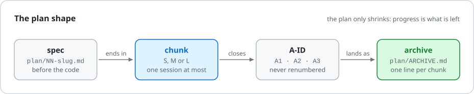
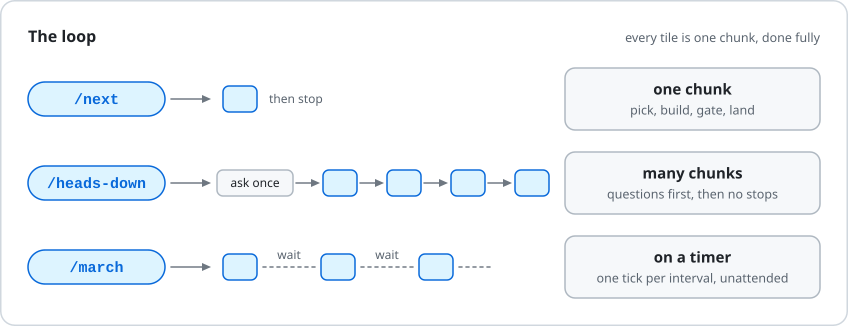
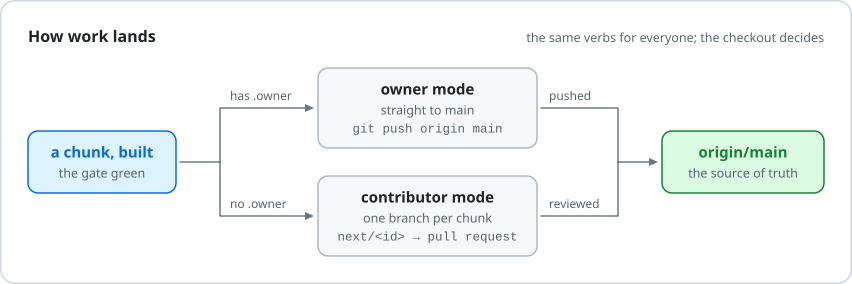
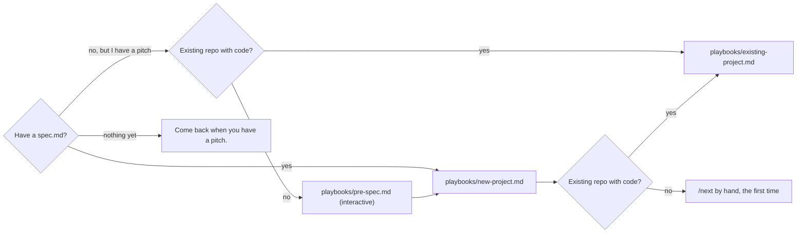

# nexus

> Turn a repo into a project that ships itself. You write a
> spec; nexus breaks it into chunks and gives your agent the
> verbs to build them one at a time: pick, build, gate,
> commit, push. Run one by hand tonight; loop it over the
> weekend. Stack-agnostic, agent-agnostic, $0 marginal on
> Claude Pro/Max and a public repo.

[](./LICENSE)
[](https://claude.com/claude-code)
[](https://www.npmjs.com/package/@usenexus/cli)
[](#)
[](#)
[](./CONTRIBUTING.md)

## Three doors in

Pick one. Each ends in the same place: your repo adopted, a
plan of chunks, and `/next` ready to build the first.

### 1. Using Claude Code? A GUI on us, free.

```bash
npx @usenexus/cli
```

Run it at your project's root. It starts a local server on
`127.0.0.1`, opens your browser, and drives your own Claude
Code login: no API key, no account. It adopts nexus if the
repo is new, then opens a live cockpit per session
([`packages/cli`](./packages/cli/README.md)).

### 2. Any other agent? Give it this prompt.

Paste it at your project's root, in Cursor, Codex, Claude Code
without the GUI, or any agent that can read files and run git:

```
Clone https://github.com/daretodave/nexus.git to
../nexus (or use ./.nexus if submoduled) if you haven't
already, then read and follow ../nexus/prompts/adopt.md
exactly, in order. Do not skip steps or invent scope beyond
what it says.
```

What it authorizes, in full: [`prompts/adopt.md`](./prompts/adopt.md).
More detail, and what to expect back:
[below](#tldr--clone--delegate-the-adoption). A pitch but no
spec yet? [Start from the pitch](#tldr--i-have-a-pitch-no-spec-yet).

### 3. By hand? Follow a playbook.

- [`playbooks/new-project.md`](./playbooks/new-project.md):
  greenfield, a spec and an empty repo.
- [`playbooks/existing-project.md`](./playbooks/existing-project.md):
  brownfield, a loop laid over code that already works.

Ten minutes to read each; [Pick a playbook](#pick-a-playbook)
routes the rest (no spec yet, polyrepo, cloud loop).

---

## How it works



**The plan.** Each spec under `plan/` says what to build and
how you'll know it's done (acceptance IDs: `A1`, `A2`, never
renumbered), and ends in chunks: S, M or L, one session at
most. A finished chunk leaves the plan as one line in
`plan/ARCHIVE.md`. The plan only shrinks; progress is what is
left. See [`concepts/plan-shape.md`](./concepts/plan-shape.md).



**The verbs.** `/next` builds one chunk fully and stops.
`/heads-down` asks every question first, claims a list, then
runs `/next` through it on defaults. `/march` is the timed
dispatcher: `/loop 45m /march` on your laptop, or the cloud
loop on GitHub Actions. Work gets into the plan through
`/plot` (a task, with its place in line), `/bug` (reproduce,
fix or plot) and `/messy` (a raw dump, refined into specs);
`/oversight` is where you steer.



**Owner mode.** The checkout decides how a chunk lands. The
owner's (an untracked `.owner` file) pushes main and settles
plan changes; every other checkout opens one pull request per
chunk on `next/<id>`, its plan changes in `plan/pending/`. See
[`playbooks/owner-mode.md`](./playbooks/owner-mode.md).

---

## A single `/march` tick, at a glance

```text
$ /march

  Triage:   0 unlabeled issues — humming on.
  Critique: deferred (4 of 12 commits since last pass).
  Expand:   not due (12 of 20 commits; deliveries first).
  Dispatch: ready chunk → /next top, 08.3 (M · closes A4, A5).

      1   Claim 08.3; read spec 08
      2   Builder: 7 components + 3 helpers, in a worktree
      3   Tests:  12 unit, 2 e2e
      4   pnpm verify   ·  typecheck · test · validate · build · e2e   ✓
      5   Close 08.3 + commit + push  (a3f1e2c)
      6   pnpm deploy:check  ·  ready ✓  →  https://thock.xyz

  08.3 archived. Spec 08: 2 chunks left. Next tick picks 08.4.
```

(Triage/Critique/Expand/Dispatch are the slash commands in
[What you get](#what-you-get), below.)

Each tick: one decision, one chunk, one verify, one commit,
one push, one deploy confirmation. Repeat under `/loop` for
hours or days, or put the same loop on GitHub Actions
([`playbooks/cloud-loop.md`](./playbooks/cloud-loop.md)) to
tick while your laptop is closed.


---

## TL;DR — clone + delegate the adoption

> Door 2 in detail. Use this if you already have a `spec.md`.
> If you only have a verbal pitch, jump down to
> [TL;DR — I have a pitch, no spec yet](#tldr--i-have-a-pitch-no-spec-yet).

### 1. Clone

Clone nexus next to your project (or your fork of it: swap the
URL here and in the prompt below):

```bash
# Sibling layout — recommended
cd <parent-of-your-project>
git clone https://github.com/daretodave/nexus.git nexus
ls
# my-project/   nexus/
```

(If you'd rather submodule it into your repo:
`git submodule add <url> .nexus` and treat `./.nexus` as the
nexus root throughout.)

### 2. Hand it to your agent

Paste the prompt from [door 2](#2-any-other-agent-give-it-this-prompt)
at your project's root (where `git status` shows your repo).
The full instruction set your agent follows lives in
[`prompts/adopt.md`](./prompts/adopt.md); read it yourself
first if you want to know exactly what you're authorizing.
(See [`prompts/README.md`](./prompts/README.md) for what lives
in that directory and why.)

### 3. Review what landed

When the agent returns, expect:

- A new commit titled `chore: adopt nexus methodology`.
- Files added: `agents.md`, `CLAUDE.md`, `plan/`, `skills/`,
  `.claude/`, `scripts/`, `.env.example`.
- Existing source code: **untouched** (per the playbooks).
- A list of `[needs-user-call]` rows in `plan/AUDIT.md` if the
  agent had to defer any decisions to you.
- `pnpm verify` (or stack-equivalent) and `pnpm deploy:check`
  specified and ready to wire once the bootstrap lands — not
  necessarily passing yet.

Read the diff. Resolve the `[needs-user-call]` rows by editing
the relevant files (or running `/oversight`). Populate `.env`
with your tokens. **Then run `/next` for the first time** —
by hand, level 0 of the intervention spectrum. Don't skip to
`/loop /march`.

### When this TL;DR is the wrong path

- Your repo is in active multi-developer flux. Use the manual
  playbook so you can choose what to merge.
- You're skeptical of unattended adoption. Use the playbook —
  read it, do it yourself, develop intuition.
- You want to deeply understand the methodology before
  applying it. Read the concept docs first; come back to the
  TL;DR if it still sounds right.

The TL;DR is for "I trust the methodology, save me the
keystrokes." The playbooks are for everyone else.

---

## TL;DR — I have a pitch, no spec yet

> Use this if you have a working name and a one-paragraph
> pitch, but no `spec.md` yet. This runs the pre-spec
> interview, writes `spec.md`, and then hands off to the
> adoption flow above. End-to-end in one paste.

Paste this at your project's root (where `git init` has run
but there's nothing else yet); swap the URL if you use a fork:

```
Clone https://github.com/daretodave/nexus.git to
../nexus (or use ./.nexus if submoduled) if you haven't
already, then read and follow ../nexus/prompts/pitch.md
exactly, in order.

Here's my pitch in my own words:

  <ONE-PARAGRAPH PITCH — what the product is, who it's for,
  what makes it interesting. Don't polish.>
```

The full instruction set — pre-spec interview, then handoff
to the adoption flow above — lives in
[`prompts/pitch.md`](./prompts/pitch.md). Pitch quality
matters: if you can't describe the product in one paragraph in
plain language, come back when you can. The agent will not
invent product direction for you.

---

## What you get

The verbs you reach for:

| Command | Job |
|---|---|
| `/next` | One chunk, done fully: pick the first ready chunk, claim it, build it (a delegated builder), gate, close, land per owner mode. |
| `/heads-down` | Every question up front, then a claimed list of chunks built one `/next` after another, on defaults, with ASCII progress. |
| `/plot` | Put a task into the plan with its place in line (`asap`, `anytime`, or worked out); `and do` builds it now. |
| `/bug` | Report a bug (a screenshot welcome). Reproduced, then fixed now if it is small, otherwise plotted. |
| `/messy` | Dump messy thoughts. Kept raw (untracked), clustered into themes, refined into specs. |
| `/oversight` | **The general-purpose interactive command.** Pause, brief, ask targeted questions, adjust the plan, promote candidates into specs. |
| `/jot` | **The user's quickfire.** Drop a free-text observation into `plan/CRITIQUE.md` and push, in seconds. The next `/iterate` tick scores it (with a `+0.5` user-source bump) and ships the fix. No questions back. |

The loop's own verbs, dispatched by `/march` or run by hand:

| Command | Job |
|---|---|
| `/march` | Outer dispatcher, the autonomous entry point: triage → critique → chunk → data → expand → iterate. |
| `/iterate` | Audit the project, ship one improvement. The endgame once the plan is empty. |
| `/critique` | External-observer pass — visit the live site as a stranger, file fresh-eyes findings. |
| `/triage` | Read open GitHub issues, classify, label, route into the address loop. |
| `/expand` | Read signals (audit, critique, spec drift, design landings, data growth) and propose candidate specs. [Posture-gated](./templates/plan/bearings.md#plan-expansion-posture): **bold** by default, **strict** to opt out. |
| `/digest` | **The night shift.** Daily: writes the morning briefing to `plan/DIGEST.md`, runs breadth checks too slow for the per-commit path, proposes gate tunings as candidates (never applies them). Own workflow (`night.yml`), never dispatched by `/march`. |
| `/tidy` | Clear claims nobody is working on; offer to close idle worktrees and delete merged branches. |
| `/rebooting` | The reboot train (with `/reboot-ready`, `/reboot-resume`): park every running loop, then resume each from its ledger. |

The building blocks underneath, some optional:

| Command | Job |
|---|---|
| `/ship-a-chunk` | The build steps for one chunk (code, tests, close) that `/next`'s builder follows. |
| `/plan-a-spec` | Write, refine or chunk one spec without shipping code. |
| `/ship-data` | Add or repair one record in the GitHub-as-DB (optional — only for projects with structured data; see [`customization/data-layer.md`](./customization/data-layer.md)). |
| `/ship-migration` | Ship one database migration — additive only, enforced by a linter; destructive changes escalate to `/oversight` (optional — only for `pure-db` / `hybrid-with-managed-postgres` projects). |
| `/bootstrap` | **Opt-in executor.** Takes a project from tokens-in to a green deploy + ticking cloud loop by driving provider CLIs (`gh`, `vercel`, `supabase`) and propagating secrets. State-aware, idempotent, never destructive. Carries its own narrow `AskUserQuestion` exception for token collection and destructive-action confirmation. See [`customization/bootstrap-automation.md`](./customization/bootstrap-automation.md). |

Plus two **opt-in** demand-pull skills for projects that need
them:

| Opt-in command | Job |
|---|---|
| `/ship-asset` | Render and ship one brand asset (OG image, favicon, social card, SVG → PNG, wordmark variant), for `Surface: site` / `hybrid` (see [`customization/branding.md`](./customization/branding.md)). Demand-pull only — drains asset findings filed by `/critique`, `/iterate`, or an `/oversight` brand pass. Omit the file if not adopting. |
| `/moderate` | Drain the four moderation queues (`held`/`flagged`/`new-account`/`appeal`) one item per tick — approve/hide is loop-drainable, delete/ban always escalates to `/oversight`. Adopt only for UGC projects (see [`customization/moderation-loop.md`](./customization/moderation-loop.md)); omit the file otherwise. |

Plus specialist sub-agents the main agent delegates to: `scout`
(open-web research), `reader` (live-site observer), `brander`
(asset rendering — only present when `/ship-asset` is adopted),
and one or two domain specialists you author for your project.

Two awareness layers wrap every push:
- **Verify gate** (pre-commit, hermetic): typecheck → unit →
  build → e2e. The e2e leg is the load-bearing piece — see
  [`customization/hermetic-e2e.md`](./customization/hermetic-e2e.md).
- **Deploy gate** (post-push, CI/CD-aware): polls your hosting
  provider until ready or error

One enforcement layer (opt-in, for Claude Code runners) turns
the hard rules from promises into walls: a permission
allowlist so unattended ticks never stall on a prompt, guard
hooks that mechanically block `--no-verify` / force-pushes /
backgrounded gates, and a pager so a stopped loop pages your
phone instead of waiting to be discovered. See
[`customization/claude-code.md`](./customization/claude-code.md)
and the walk-away runbook,
[`playbooks/hands-off.md`](./playbooks/hands-off.md).

State files that carry intent across context loss:
- `plan/README.md` + the specs — what's left to build, as
  chunks with acceptance IDs (the plan only shrinks; see
  [`concepts/plan-shape.md`](./concepts/plan-shape.md));
  `plan/pending/` holds plan changes waiting for the owner's
  settle, and the claims branch says who builds which chunk
- `plan/AUDIT.md` (+ `data/BACKLOG.md` + `plan/CRITIQUE.md`) —
  queues the loop drains

---

## When this is the right tool

You want this when:

- You have a **definite product** in mind, captured in some form
  of `spec.md`. The methodology assumes you know roughly what
  you're building.
- You're willing to invest **2–3 hours of setup** to get hours
  to days of unattended autonomous build time.
- You can let `main` deploy automatically — the loop assumes
  push = deploy, and gates around that contract.
- You're comfortable having an AI agent decide-and-ship without
  per-commit review. (`/oversight` and the audit logs are how
  you stay honest after the fact.)

You **don't** want this when:

- The product is exploratory, you're discovering as you build,
  and every decision needs human input. (Use the agent
  conversationally instead.)
- The repo has security-critical paths where every commit needs
  human review. (The deploy gate catches regressions, but it's
  not a security review.)
- You have no spec — even a one-pager — to anchor the build
  plan. (Write one first; it's worth a day.)

---

## Pick a playbook

Door 3, routed:



### → [`playbooks/pre-spec.md`](./playbooks/pre-spec.md)

Have a pitch, no spec yet. A 30-minute interactive interview
that produces `spec.md`, a `bearings.md` stub (the file that
locks your stack, conventions, and standing decisions), and an
optional visual-system commission prompt. The only nexus playbook
where `AskUserQuestion` is allowed — see the carve-out at
the top of the playbook. Output feeds straight into
`new-project.md`.

### → [`playbooks/new-project.md`](./playbooks/new-project.md)

Greenfield. You have a `spec.md` and an empty (or near-empty)
repo. This walks you through the substrate — bearings, a
plan with two starter specs, design exports landing pad, the
skill set — and ends with you running `/next` for the first
time.

### → [`playbooks/existing-project.md`](./playbooks/existing-project.md)

Brownfield. The repo already has code, history, conventions,
maybe even tests. You want to add the autonomous loop on top
without breaking what works. This walks you through the
non-destructive overlay — adding `skills/`, `plan/`, `.claude/`,
and the gates without rewriting the existing app.

### → [`playbooks/polyrepo.md`](./playbooks/polyrepo.md) *(variant)*

Outgrown one repo? Once a project has multiple shippable units,
a plan that should stay private while the product is public, or
plan history that shouldn't share a log with product history,
split `plan/` into its own repo with each product a sibling.
Same skills, same state-file shapes — the tick's atomic act
just spans two repos, pushed product-first.

### → [`playbooks/workspace.md`](./playbooks/workspace.md) *(variant)*

Outgrown polyrepo's two repos? Past `plan/` + one product, the
same split generalizes to a workspace: an un-versioned local
root — never its own git repo — holding `plan/` and every
product as peers under one GitHub org.

### → [`playbooks/ci-providers.md`](./playbooks/ci-providers.md)

The deploy gate is the only piece that varies a lot per project.
This is the matrix: Netlify, Vercel, Fly.io, Cloudflare Pages,
GitHub Pages, Render, self-hosted, and "no deploy yet". For each,
how `pnpm deploy:check` is wired and what state file it polls.

### → [`playbooks/cloud-loop.md`](./playbooks/cloud-loop.md) *(opt-in)*

Once your local loop is happy, optionally put the same loop on
GitHub Actions so it ticks while your laptop is closed. A few
files, the secrets, one validation run. One repo variable picks
how ticks land: pushed to main (owner mode) or, by default, one
chunk per pull request, built by an agent that holds no token.
Defaults to `github-actions[bot]` author for zero-config setup;
opt-in to your own GitHub identity if you want a uniform git
log. **Free to operate** if your repo is public + you're on
Claude Pro/Max. Already running your own Actions and a local
workflow? [`playbooks/cloud-loop-existing-actions.md`](./playbooks/cloud-loop-existing-actions.md)
adds the loop beside them, step by step.

Don't reach for this until your verify gate is genuinely
hermetic and the local loop has run cleanly for a few days —
the cloud surfaces every flake.

### → [`playbooks/hands-off.md`](./playbooks/hands-off.md)

The walk-away runbook. "Unattended" and "hands-off" are
different claims — this closes the seven silent-death modes
between them: permission walls, silent stops, one bad chunk
freezing the beast, drift where nobody's looking, expiring
secrets, budget surprises, and two loops racing one branch.
Ends in a pre-flight checklist and a 24-hour dry run.

### → [`playbooks/recovery.md`](./playbooks/recovery.md)

The incident runbook, written to be read during the incident.
Safe-stop first, one triage tree, then a numbered procedure
per scenario — red deploys, wedged git, churn loops, drift,
outages, expired secrets, corrupted state. Recovery never
force-pushes and never bypasses a gate.

Prefer a numbered checklist over picking a playbook? Jump to
[How to use this kit](#how-to-use-this-kit) below.

---


## The intervention spectrum

The loop scales from "I drive every step" to "I leave for the
weekend." See [`intervention-spectrum.md`](./intervention-spectrum.md)
for the full ladder; the short version:

| Level | What you do | What the loop does |
|---|---|---|
| **0 — Manual** | Run `/next` (or any slash command) by hand. Review every diff. | Ships exactly what you ask, one chunk at a time. |
| **1 — Supervised** | `/march` once. Review the diff. `/march` again. | One tick at a time, attended. |
| **2 — Loop, attended** | `/heads-down` over a claimed list, or `/loop 30m /march`. Stay around. | Ticks every 30m. You can see deploys, intervene with `/oversight`. |
| **3 — Loop, unattended** | `/loop 30m /march`. Walk away. | Hours of autonomous work. Deploy gate + audit trail keep it honest. |
| **4 — 80-hour beast** | Same. Come back days later. | Every chunk archived, the plan empty, `/iterate` carrying the load. The site iterates itself. |

Levels 3–4 require:
- A green deploy gate is reachable (auth token + hosting wired).
- The plan has enough specs to chew through without running
  out (or `/iterate` carries the load once the plan is
  empty).
- `/oversight` works (you'll need it eventually).

Level 4 is where the methodology earns its name. It's also the
hardest to reach — most projects get to level 3 and stay there.

---

## What's in this kit

```
nexus/
├── README.md                          # this file
├── intervention-spectrum.md           # the levels in detail
├── agents.md                          # nexus's OWN rule book (the kit runs on itself)
├── CLAUDE.md                          # pointer at agents.md (Claude Code only auto-loads CLAUDE.md from repo root)
├── CONTRIBUTING.md                    # how to contribute
├── prompts/                           # canonical paste-prompts — versioned, public API
│   ├── README.md                      # what these are, how the short paste uses them
│   ├── adopt.md                       # the full "Adopt nexus" agent prompt
│   └── pitch.md                       # the full pitch-to-adopted agent prompt
├── package.json                       # the kit's own verify gate wiring
├── assets/                            # generated SVG diagrams (scripts/diagrams.mjs); hand edits fail the gate
├── scripts/
│   ├── verify.mjs                     # the kit's own gate: links · tree · discover · placeholders · anatomy · emoji · dualshell · chunks · scripts · workflows · diagrams
│   ├── diagrams.mjs                   # writes every assets/*.svg from one style table; --check is the gate's diagrams leg
│   ├── __tests__/diagrams.test.mjs    # the generator's own suite (run by the diagrams leg)
│   ├── pulse.mjs                      # offline instrument panel: queue/build-plan/candidate counts, no network
│   ├── plan/settle.mjs                # npm run settle: the owner folds plan/pending/ into the plan (+ pending, settled, config, footguns)
│   ├── plan/progress.mjs              # npm run progress: where a spec stands, ASCII (what /next status and /heads-down print; --json for the GUI)
│   ├── plan/order.mjs                 # npm run order: the plan in /next's pick order (+ plan-check.mjs, the template's twin)
│   ├── claims.mjs                     # npm run claims: who builds which chunk (+ claims-codec.mjs, owner.mjs)
│   ├── git/push-policy.mjs            # pre-push: main on origin/upstream is the owner's checkout's alone (owner mode)
│   ├── announce.mjs                   # npm run announce: the notice board every loop on this machine reads
│   ├── ledger.mjs                     # npm run ledger: each session's live ledger (star names; a crash resumes like a reboot)
│   ├── worktree.mjs                   # npm run worktree: close a worktree without deleting through its links; list for /tidy
│   ├── upgrade-plan.mjs               # the v1 to v2 plan converter (the template's twin; nexus's own plan is already v2)
│   ├── adopt-dryrun.mjs               # opt-in: mechanizes new-project.md's plan starters + copy + placeholder-sweep + prune steps (Git Bash on Windows)
│   ├── new-skill.mjs                  # skill scaffolder: emits skills/<name>.md + .claude/commands/<name>.md
│   └── install-hooks.mjs              # opt-in: arms node scripts/verify.mjs (pre-commit) + the push policy (pre-push)
├── playbooks/
│   ├── pre-spec.md                    # pitch → spec.md (interactive)
│   ├── new-project.md                 # greenfield setup
│   ├── existing-project.md            # brownfield retrofit
│   ├── windows-notes.md               # PowerShell twins + Windows hazards page
│   ├── ci-providers.md                # deploy-gate variations
│   ├── cloud-loop.md                  # opt-in GitHub Actions loop
│   ├── cloud-loop-existing-actions.md # adding it beside your own Actions and local workflow (the GUI's checklist)
│   ├── hands-off.md                   # the walk-away runbook — close the seven silent-death modes
│   ├── recovery.md                    # the incident runbook — safe-stop, triage tree, procedures
│   ├── upgrade.md                     # an older plan shape → specs + chunks; pin with plan/nexus.lock
│   ├── owner-mode.md                  # how work lands: .owner pushes main + settles, else next/<id> PRs; rulesets
│   ├── polyrepo.md                    # variant: plan/ as its own repo + sibling product repos
│   └── workspace.md                   # variant: un-versioned root + org-per-project, past two repos
├── concepts/
│   ├── architecture.md                # the whole system in one read
│   ├── loop-shapes.md                 # the genus: dispatcher, night shift, heartbeat, concierge, pollinator, lanes, meta-loop
│   ├── plan-shape.md                  # specs, chunks, acceptance IDs: the plan only shrinks
│   ├── skills-anatomy.md              # how to read/write a skill file
│   └── asking-well.md                 # the question-shape convention
├── customization/
│   ├── verify-gate.md                 # composing the right pre-commit checks
│   ├── hermetic-e2e.md                # the e2e leg — patterns, alt-port DB seeding, smoke walker
│   ├── data-layer.md                  # gh-as-db / hybrid-with-managed-postgres / pure-db / saas-cms / none
│   ├── sub-agents.md                  # designing your specialists
│   ├── lanes.md                       # alpha/beta/gamma — three agents, one branch (attended fan-out)
│   ├── claims.md                      # who builds which chunk: orphan claims branch, CAS, session-scoped, 24h TTL
│   ├── sessions.md                    # many sessions on one machine: notice board, live ledger, worktrees, reboot train
│   ├── claude-code.md                 # the Claude Code layer — permissions, guard hooks, pager, model routing
│   ├── branding.md                    # opt-in /ship-asset + brander agent (Surface-gated)
│   ├── visual-system.md               # design system layer (upstream of branding/assets)
│   ├── moderation-loop.md             # mod queues + /oversight escalation (for UGC projects)
│   ├── external-services.md           # the setup/ paradigm — pre-flight every dashboard
│   ├── bootstrap-automation.md        # the executor that drives provider CLIs end-to-end (paired with external-services.md)
│   ├── auth-aware-critique.md         # let /critique walk past a login wall (5 patterns; Auth: in bearings)
│   ├── lessons-layer.md               # reflexes + domain-keyed lessons, hard caps, staged-hardening lint
│   └── identity-layer.md              # identity/ + the footgun ladder (seen twice -> automate); the alternative
├── skills/                            # nexus's OWN skills — the loop that ships the kit
│   ├── next.md                        # /next — one chunk, done fully (+ next/build.md, next/land.md)
│   ├── heads-down.md                  # /heads-down — ask up front, then loop /next for hours
│   ├── plot.md                        # /plot — a task into the plan with its place in line (+ bug.md: /bug)
│   ├── messy.md                       # /messy — a raw dump into specs (the GUI's explode)
│   ├── tidy.md                        # /tidy — clear dead claims, close idle worktrees (worktree.mjs)
│   ├── rebooting.md                   # /rebooting, /reboot-ready, /reboot-resume — the reboot train
│   ├── march.md                       # + ship-a-chunk (/next's build steps), iterate, critique,
│   │                                  #   triage, expand, oversight, jot
│   ├── digest.md                      # /digest — nightly briefing, never dispatched by march
│   └── lessons-pr.md                  # /lessons-pr — turn a sibling's NEXUS_LESSONS.md into a PR
├── plan/                              # nexus's OWN state files (specs + chunks, pending, archive, queues)
├── identity/                          # nexus's OWN identity layer: footguns.md (the ladder) + decisions/
├── .claude/                           # nexus's OWN commands + settings.json + guard hook
├── .github/                           # nexus's OWN cloud loop (march.yml + CLOUD_LOOP.md + ISSUE_TEMPLATE/) + publish.yml + cli-ci.yml + scripts-ci.yml
├── packages/
│   └── cli/                           # @usenexus/cli — npx GUI for Claude Code (React+Vite; design/handoff/ is its UI source of truth; publish.yml ships it, cli-ci.yml tests it)
└── templates/
    ├── README.md                      # how to apply the templates
    ├── agents.md                      # rule-book template (target: repo root)
    ├── design-prompt.md               # paste into a fresh agent to commission a visual system
    ├── plan/                          # → repo's plan/
    │   ├── README.md                  # the roadmap: lanes + one row per spec
    │   ├── 01-bootstrap.md            # starter spec (design, acceptance IDs, chunks)
    │   ├── 02-canonical-sibling.md    # starter spec: the first feature surface
    │   ├── ARCHIVE.md                 # one line per finished chunk
    │   ├── pending/README.md          # plan changes waiting for the owner's settle
    │   ├── nexus.lock                 # the kit version + plan shape this repo follows
    │   ├── bearings.md
    │   ├── AUDIT.md
    │   ├── CRITIQUE.md
    │   ├── PHASE_CANDIDATES.md         # /expand's candidate specs, /oversight promotes
    │   ├── reflexes.md                # ≤50-line always-read core (adopt-by-need)
    │   ├── lessons.md                 # domain-keyed corpus, read by offset (adopt-by-need)
    │   └── CURRENT-STATE.md           # brownfield retrofit only (adopt-by-need)
    ├── identity/                      # → repo's identity/ (adopt-by-need): what outlives the plan
    │   ├── README.md                  # the rules: principles, decisions, glossary, footgun ladder
    │   ├── principles.md              # P# promises
    │   ├── decisions/README.md        # D# format (settle writes decisions/<year>.md)
    │   ├── glossary.md
    │   └── footguns.md                # Open / Watch / Guarded; seen twice -> automate
    ├── skills/                        # → repo's skills/
    │   ├── next.md                     # one chunk, done fully: claim, delegated build, gate, pending close, land
    │   ├── next/build.md               # /next's build detail: worktree, builder brief, Workflow shape
    │   ├── next/land.md                # /next's close + land: settle, pending file, main vs PR
    │   ├── heads-down.md               # ask up front, claim a list, loop /next on defaults, ASCII progress
    │   ├── plot.md                     # a task into the plan with its slot (asap|anytime|auto|peek; and do)
    │   ├── bug.md                      # reproduce; fix now via /plot … and do, or plot it
    │   ├── messy.md                    # raw dump -> untracked plan/messy/, themes -> specs via a pending file
    │   ├── tidy.md                     # clear dead claims; offer idle worktrees + merged branches
    │   ├── rebooting.md                # reboot train: announce, ack, one resume line per loop
    │   ├── reboot-ready.md             # reboot train: park this loop (children, work, claims, ledger)
    │   ├── reboot-resume.md            # reboot train: pick a parked or fallen loop up from its ledger
    │   ├── ship-a-chunk.md
    │   ├── ship-data.md                # omit if no structured data layer
    │   ├── ship-migration.md           # omit unless Structured data: pure-db / hybrid-with-managed-postgres
    │   ├── ship-asset.md               # omit unless Surface: site / hybrid
    │   ├── moderate.md                 # omit unless UGC (see customization/moderation-loop.md)
    │   ├── plan-a-spec.md
    │   ├── iterate.md
    │   ├── critique.md
    │   ├── triage.md
    │   ├── expand.md
    │   ├── march.md
    │   ├── oversight.md
    │   ├── jot.md                      # user-input quickfire — append a row to plan/CRITIQUE.md
    │   ├── digest.md                   # the night shift — morning briefing + breadth checks
    │   └── bootstrap.md                # opt-in executor (see customization/bootstrap-automation.md)
    ├── claude/                        # → repo's .claude/ (+ CLAUDE.md → repo root)
    │   ├── CLAUDE.md                  # short pointer at agents.md
    │   ├── settings.json              # permission allowlist + hook wiring
    │   ├── hooks/guard.mjs            # mechanical hard rules (PreToolUse + Stop)
    │   ├── commands/                  # one terse pointer per skill
    │   └── agents/                    # generic sub-agent templates
    ├── data/                          # → repo's data/ (if using gh-as-db or hybrid)
    ├── setup/                         # → repo's setup/ (per-external-service runbooks)
    │   ├── 00_files.md                # the manifest / index template
    │   ├── NN_service.md              # per-service runbook template
    │   └── bootstrap.example.json     # /bootstrap manifest (copy → bootstrap.local.json)
    ├── .github/                       # → repo's .github/ (opt-in cloud loops)
    │   ├── workflows/march.yml        # the dispatcher: owner job, or PR mode (pick/build/land/release)
    │   ├── workflows/pr-flow.yml      # PR mode: a closed PR's claims are released
    │   ├── workflows/pr-resolve.yml   # PR mode: main merged into conflicted PRs
    │   ├── actions/setup/action.yml   # the project's toolchain, shared by every tick job
    │   ├── workflows/night.yml        # the night shift: /digest + breadth checks
    │   ├── workflows/heartbeat.yml    # the immune system: model-free watchdog
    │   ├── workflows/nightly-smoke.yml # model-free SMOKE_SAMPLE=full walk (omit if night.yml owns breadth)
    │   ├── ISSUE_TEMPLATE/             # bug_report, friction, idea, needs_user, config
    │   └── CLOUD_LOOP.md              # operator's guide (lives in repo)
    ├── scripts/
    │   ├── deploy-check.mjs           # multi-provider deploy gate
    │   ├── loop-issue.mjs             # GitHub issue mirror (findings + specs)
    │   ├── notify.mjs                 # the pager — blocked is loud
    │   ├── pulse.mjs                  # offline instrument panel: queue/build-plan/candidate counts, no network
    │   ├── bootstrap.mjs              # provider-CLI executor (opt-in)
    │   ├── lint-migration.mjs         # additive-migration linter (pairs with ship-migration.md)
    │   ├── refresh-critique-session.mjs # Pattern B session refresh (omit unless Auth: is set)
    │   ├── check-secrets-liveness.mjs # GH_TOKEN + CRITIQUE_* liveness probe (omit unless Auth: is set)
    │   ├── stack-lifecycle.mjs        # Pattern B port/health/state helpers (omit unless hermetic e2e is Pattern B)
    │   ├── new-skill.mjs              # skill scaffolder: emits skills/<name>.md + claude/commands/<name>.md
    │   ├── install-hooks.mjs          # adoption runs it: pnpm verify (pre-commit) + the push policy (pre-push)
    │   ├── plan-check.mjs             # the plan-shape gate: Measure lines, chunk lines, A-ID coverage, archive
    │   ├── owner.mjs                  # effective owner mode (.owner + .nexus/local.json)
    │   ├── git/push-policy.mjs        # pre-push: refuses main on origin/upstream outside owner mode; claims ref passes unchecked
    │   ├── plan/pending.mjs           # pending files: a branch's plan change, counted closed until it settles
    │   ├── plan/settle.mjs            # the owner's settle: pending files -> plan edits, one commit on main
    │   ├── plan/settled.mjs           # the plan as it reads once pending edits settle
    │   ├── plan/config.mjs            # per-repo settle config (plan/settle.json)
    │   ├── plan/footguns.mjs          # footgun list format + budget lint
    │   ├── plan/progress.mjs          # ASCII progress: 24-char bar, closed struck, <--- [here], ETAs (S 1h, M 2.5h, L 5h); --json: the same as data
    │   ├── plan/order.mjs             # the plan in /next's pick order, simulated (/plot's before/after; --mark)
    │   ├── claims-codec.mjs           # the claims rules, pure (any claimant imports them)
    │   ├── claims.mjs                 # who builds what: orphan claims branch, compare-and-swap, --json
    │   ├── announce.mjs               # the notice board: owner lines outrank the command; REBOOT preempts
    │   ├── ledger.mjs                 # each session's live ledger (.nexus/sessions/), star names, fallen = stale beat
    │   ├── worktree.mjs               # close a worktree safely (links unlinked first); list for /tidy
    │   ├── workflow-lint.mjs          # workflow rules: secrets on hosted runners, no secret in run-name or a job env
    │   ├── cloud/tick.mjs             # PR-mode tick: pick + claim, fence, land the PR, release
    │   ├── pr/resolve.mjs             # pr-resolve's resolver: merge main into conflicted PRs
    │   ├── upgrade-plan.mjs           # v1 to v2: shipped phases -> archive lines, pending -> spec stubs, blocked -> Held; dry run by default
    │   ├── __tests__/loop-issue.test.mjs # unit tests, node:test, no devDeps
    │   ├── __tests__/plan-check.test.mjs # unit tests for plan-check.mjs
    │   ├── __tests__/pending.test.mjs # pending files, config, settled view
    │   ├── __tests__/settle.test.mjs  # settle's pure functions
    │   ├── __tests__/settle-run.test.mjs # settle end to end in a scratch repo (offline)
    │   ├── __tests__/claims-codec.test.mjs # the claims rules
    │   ├── __tests__/push-policy.test.mjs # the push policy, pure
    │   ├── __tests__/progress.test.mjs # the progress view, pure
    │   ├── __tests__/progress-run.test.mjs # progress main() from a spaced path, over git (offline)
    │   ├── __tests__/announce.test.mjs # the notice board
    │   ├── __tests__/ledger.test.mjs  # the live ledger
    │   ├── __tests__/order.test.mjs   # the simulated pick order
    │   ├── __tests__/workflow-lint.test.mjs # the workflow rules
    │   ├── __tests__/tick.test.mjs    # the PR-mode tick
    │   ├── __tests__/resolve.test.mjs # the resolver
    │   ├── __tests__/tick-run.test.mjs # the PR-mode tick over git (offline)
    │   ├── __tests__/upgrade-plan.test.mjs # the v1 to v2 converter, pure
    │   ├── __tests__/upgrade-plan-run.test.mjs # the converter over git, dry run and --write (offline)
    │   ├── __tests__/bootstrap.test.mjs # bootstrap's cloud-loop plan, pure
    │   ├── __tests__/worktree.test.mjs # worktree close and list in scratch repos (offline)
    │   ├── __tests__/push-policy-hook.test.mjs # the pre-push hook end to end (offline)
    │   └── __tests__/claims.test.mjs  # claims over git in scratch repos (offline)
    ├── env/
    │   └── env.example                # NETLIFY_AUTH_TOKEN, GH_TOKEN, NOTIFY_*, etc.
    └── workspace/                      # → workspace root, not any repo (adopt-by-need)
        ├── CLAUDE.md
        ├── AGENTS.md
        ├── README.md
        └── REPOS.md
```

The templates are the artifacts. Everything else explains how to
adapt them.

---

## How to use this kit

> This is the manual-path equivalent of
> [Pick a playbook](#pick-a-playbook) above — skip
> it if you already delegated adoption to an agent.

1. **Read this README.** (You're here.)
2. **Read [`concepts/architecture.md`](./concepts/architecture.md)**
   for the one-page mental model.
3. **Decide which playbook applies** — new project or existing.
4. **Read your playbook end-to-end before starting.** It's ~10
   minutes; you'll save hours.
5. **Copy templates into your repo** per the playbook. Replace
   all 8 placeholders (see
   [`templates/README.md`](./templates/README.md#placeholders)).
   Write your real specs into `plan/`.
6. **Wire your CI/CD provider** per
   [`playbooks/ci-providers.md`](./playbooks/ci-providers.md).
7. **Customize** per the docs in `customization/` — pick which
   skills apply, which sub-agents you need, what your verify
   gate looks like.
8. **First invocation: `/next`.** Don't start with
   `/loop /march` — run one chunk manually, see the shape of
   the work, then escalate.

---

## What this is *not*

- **Not a code generator.** It's a methodology. The actual code
  is written by the agent, chunk by chunk. Templates are docs +
  prompts, not source.
- **Not framework-specific.** The skills assume Node + git +
  some test runner. Stack details (Next.js, Django, Rails) live
  in the project's own `bearings.md`, not here.
- **Not a replacement for product thinking.** The autonomous
  loop ships what `spec.md` and `plan/` describe. Garbage in,
  garbage out.
- **Not a substitute for `/oversight`.** The loop drifts. You
  must check in, run `/oversight`, course-correct. The whole
  system is designed around that interaction; don't skip it.

---

## nexus runs on nexus

This repo eats its own dogfood — it is an adopted nexus
project. The ouroboros, concretely:

- **Its own verify gate.** `node scripts/verify.mjs` — eleven
  hermetic legs (every relative link resolves, the kit tree
  matches disk, no orphaned doc, placeholder vocabulary
  enforced, skill anatomy enforced, no emojis, dual-shell
  parity checked, the plan shape true, the plan and claims
  scripts' own suites green, the workflows linted, every
  diagram under `assets/` what its generator draws). On its
  first ever run it caught five real defects in this repo.
  The gate works.
- **Its own plan.** `plan/README.md` and its specs carry the
  kit's specs and chunks, in the same shape adopters use;
  `plan/AUDIT.md` and the candidate queue are seeded with
  real findings from deep survey passes — the loop's food.
- **Its own skills.** `skills/` holds the kit's adapted verbs.
  The best one is `/critique`: a **dry-run adoption** — a
  fresh-eyes agent follows this README's TL;DR into a scratch
  directory as a stranger and files every friction point.
- **Its own cloud loops — plural.** The dispatcher
  (`march.yml`) ticks four times a day on Sonnet; the night
  shift (`night.yml`) writes a daily morning briefing to
  `plan/DIGEST.md`; a model-free heartbeat (`heartbeat.yml`)
  watches them both. Label any issue `loop:do` and the next
  tick treats it as a command. The full genus:
  [`concepts/loop-shapes.md`](./concepts/loop-shapes.md);
  operator guide:
  [`.github/CLOUD_LOOP.md`](./.github/CLOUD_LOOP.md).

If you want to see the methodology run before adopting it,
watch this repo's commit log and Issues tab — every spec has
a mirror issue, every cloud commit carries its run URL.

---

## Provenance

This methodology evolved across:

- **tickpedia** (~2025) — A data-heavy site with structured
  records, page families, and weekly automation. Established
  the **`ship-a-chunk` + `plan/`** pattern.
- **thock** (~2026) — An editorial content hub. Added
  **`/ship-data`, `/critique`, `/triage`, `/oversight`,
  `/march`** — the full autonomous family.
- **semilayer** (~2026) — A database intelligence layer; the
  proto-nexus ancestor (numbered steps, checkbox roadmap,
  hermetic-e2e doctrine).

If you're working with one of those repos, you'll see this kit's
patterns there directly. If you're applying it to a fresh repo,
this kit is the distilled set.

The templates here are **opinionated**: they encode a specific
working style (commit-and-push as one act, no `Co-Authored-By`,
no emojis, hermetic verify gate, post-push deploy gate, audit
trail in commit bodies). Override what doesn't fit your culture
— the bones of the methodology survive plenty of customization.

---

## Hard rules carried across every project

These are baked into every skill template and worth surfacing
upfront:

1. **Land per owner mode.** The owner's checkout (an untracked
   `.owner`) commits and pushes main as a single atomic act and
   settles the plan; every other checkout lands on `next/<id>`
   as a pull request, stacked at most two deep. No unpushed
   commits between ticks. See
   [`playbooks/owner-mode.md`](./playbooks/owner-mode.md).
2. **No `Co-Authored-By:` trailers, no emojis** — anywhere.
3. **The verify gate is non-negotiable.** No `--no-verify`. No
   force-push. No destructive resets.
4. **Tests alongside code** — never "add tests later".
5. **The deploy gate runs after every push.** A red deploy is a
   blocked tick.
6. **Ask before the first write, or not at all.** A skill run
   by a person may ask once, in one batch, before it writes
   anything; after that it decides and ships. Under a loop it
   never asks: it takes defaults and logs each one, and a
   question that outlives the run goes to the `/oversight`
   queue. `/oversight` asks anything, any time; `/bootstrap`
   (token collection and destructive-action confirmation) and
   `/lessons-pr` (planning step only) keep their documented
   carve-outs.
   `pre-spec.md`'s one-time interactive interview, before any
   skill exists yet (see
   [Pick a playbook](#pick-a-playbook)), is allowed
   separately — it isn't a skill yet at that point.

---

## License

This kit is yours to copy, adapt, and use. The templates are
prompts and methodology — there's nothing to license. Use them.

If you build something with it, you don't owe anyone attribution.
If you want to give some back, write up your own variation and
add a link here. The methodology improves with every honest
application.
